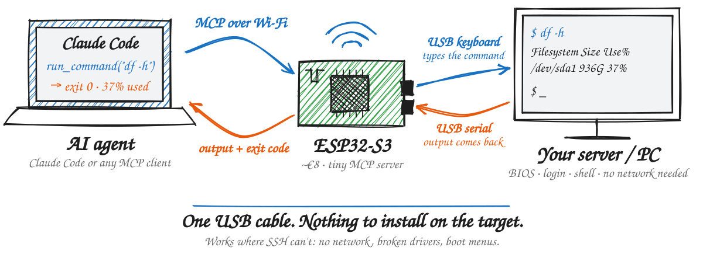

# usb-terminal-mcp

Give an AI agent a terminal on any computer, through a single USB cable and no software on the target.



An ESP32-S3 plugs into the target computer and shows up as two ordinary USB devices:

- a **keyboard**, so the agent can type anywhere: BIOS, boot menu, login prompt, a shell;
- a **serial port** (`/dev/ttyACMx`), which carries terminal output back, so the agent can read results.

The ESP32 joins your Wi-Fi and runs a small [MCP](https://modelcontextprotocol.io) server, so Claude Code (or any MCP client) can call `run_command("journalctl -b -p err")` and get the output and exit code back.

It was built to rescue a headless Ubuntu server that lost Wi-Fi after an automatic kernel update. In that situation SSH and remote-desktop tools don't work, but a USB keyboard always does.

## Hardware

- An **ESP32-S3** board with native USB, e.g. ESP32-S3-DevKitC-1 N16R8 (~€8). The classic ESP32, ESP32-C3 and ESP32-WROOM boards **won't work**: they have no native USB.
- Boards with two USB-C ports:
  - **USB-OTG** (native USB) → the target computer
  - **USB-UART** → your PC, for flashing and logs (optional once deployed)

If both are connected at once, plug the UART side in first. On some clone boards, two hosts can feed 5V into each other.

## Install (no toolchain needed)

1. Open the **[web installer](https://stefanozampieri.github.io/usb-terminal-mcp/)** in Chrome or Edge and plug the board's **UART** port into your computer.
2. Click **Install** to flash the firmware from the browser.
3. Enter your Wi-Fi when asked. It's sent to the board over USB ([Improv](https://www.improv-wifi.com/serial/)) and stored only on the board.
4. Click **Visit device**. The setup page shows the ready-to-paste command for your agent:
   ```bash
   claude mcp add --transport http usb-terminal http://<ip>/mcp --header "Authorization: Bearer <token>"
   ```
5. Plug the board's **USB-OTG** port into the computer the agent should control.

The access token is generated on the board itself at first boot, so the published firmware contains no secrets. Reserve the board's IP in your router, or use `usb-terminal-XXXX.local`.

### No Chrome, or changing Wi-Fi later

When the board has no working Wi-Fi for 30 s, it opens a setup network called `usb-terminal-XXXX`. Join it from a phone and the setup page opens as a captive portal, where you pick a network and get the agent command. Binaries for other flashers are attached to each [release](https://github.com/stefanozampieri/usb-terminal-mcp/releases) (flash at offset 0).

### The BOOT button

- **Short press:** shows the token on `http://<ip>/setup` for 2 minutes, and prints the agent command on the UART log. The setup page also shows it for 10 minutes after Wi-Fi setup. Otherwise it stays hidden, so being on your LAN isn't enough to read it.
- **Hold for 5 seconds:** factory reset, which erases the Wi-Fi details, the token and the settings.

## Build it yourself

With [arduino-cli](https://arduino.github.io/arduino-cli/), the `esp32:esp32` core (3.2) and `ArduinoJson` (7.x):

```bash
arduino-cli compile --upload -p COM7 \
  --fqbn "esp32:esp32:esp32s3:USBMode=default,CDCOnBoot=default,FlashSize=4M,PartitionScheme=min_spiffs,PSRAM=opi" \
  firmware
```

- `USBMode=default` (TinyUSB) is required for the keyboard and serial port.
- `PSRAM=opi` suits N8R8/N16R8 boards and gives a 1 MB output buffer. Use `PSRAM=disabled` on other boards (32 KB buffer).
- Optional: copy `firmware/secrets.example.h` to `firmware/secrets.h` to bake in Wi-Fi and/or a token. Values there take precedence over what's saved on the board.

The UART log (115200 baud) prints the IP address and setup hints. Send `i` for a status report.

## Tools

| Tool | What it does |
|---|---|
| `run_command` | Runs a shell command and returns the output and exit code. If it's still running at the timeout (or waiting for a password or y/n prompt), it returns the output so far. |
| `terminal_read` | New output since the last read; follows long commands. |
| `terminal_send` | Raw input, e.g. `y\n` to answer a prompt. |
| `attach_terminal` | Types the one-liner that mirrors the console session to the serial port (see below). |
| `type_text` / `press_keys` | Raw keyboard: text, shortcuts (`ctrl+alt+f2`, `down*3 enter`). Works in BIOS and boot menus, but returns no output. |
| `configure` | Keyboard layout (`us`, `us-intl`, `it`), input mode, typing speed. Saved across reboots. |
| `get_status` | USB and serial connection, mode, Wi-Fi. |

## Two ways to get output

### Keyboard + mirror (default, nothing to install)

With the console logged in at a shell prompt, the agent calls `attach_terminal`, which types:

```bash
D=$(ls /dev/serial/by-id/*USB_Terminal* | head -n1); sudo chown $USER "$D" && script -qf "$D"
```

From then on, everything in that console session is copied to the ESP32.
- Commands are typed on the keyboard, so you see everything happen on the screen.
- When `sudo` asks for a password, **you type it on the machine**; the agent never needs it.
- `exit` ends the mirror.

### Serial console (fully headless)

A login shell runs directly on the serial port, and the keyboard isn't used. Set it up once:

```bash
sudo systemctl enable --now serial-getty@ttyACM0.service
```

Then call `configure` with `input_mode: serial`. The getty asks for a login. To make it fully unattended, you can enable autologin with `sudo systemctl edit serial-getty@ttyACM0` (`ExecStart=-/sbin/agetty --autologin <user> --keep-baud 115200 - $TERM`). Be aware this gives a shell to anyone who can reach the MCP endpoint.

## Keyboard layouts

A USB keyboard sends key *positions*, so the firmware must know the target's layout. If symbols come out wrong, change it with `configure`:
- `us`: plain US.
- `us-intl`: US-International, where `'` and `"` are dead keys (`'i` → `í`). The firmware types a space after each dead key so it produces the plain character.
- `it`: Italian.

## Security

This is a remote keystroke-injection device, so treat it like a root shell:
- The bearer token is the only lock. If it leaks, hold BOOT for 5 seconds to factory reset, which generates a new token.
- The MCP endpoint is plain HTTP on your LAN. Don't expose it to the internet.
- The setup network is open (no password) and only exists while the board has no working Wi-Fi.
  - On a board that has **never** been configured, anyone who joins it can set the Wi-Fi and will then see the token, so set up new boards right away.
  - Once a board has been configured, changing its Wi-Fi or seeing its token always takes a BOOT press (physical access), even when it falls back to the setup network.
- Unplug it when you're done.

## Limits

- **No screen capture.** Output only exists once Linux is running and the terminal is attached. BIOS, boot menus and early boot errors still need someone to look at the screen, or an HDMI-capture KVM.
- Full-screen programs (`vim`, `less`, `top`) don't read well. The mirror sets `PAGER=cat`; prefer non-interactive flags.
- One agent at a time: two agents typing at once interleave their keystrokes.

## Status

Tested on Ubuntu 24.04 (kernel 6.8) on an ESP32-S3 N16R8:
- The keyboard path diagnosed and fixed the server described above.
- In keyboard + mirror mode, `run_command`, `terminal_read`, multi-line commands, timeouts and exit codes all work.
- Serial-console mode hasn't been field-tested yet.

## Credits

Credits go to [openwakeword.com](https://openwakeword.com), where this project was made.

## License

[MIT](LICENSE): free to use, modify and share, including commercially. Keep the copyright notice, which credits
[openwakeword.com](https://openwakeword.com), in any copy or substantial portion of the code.
